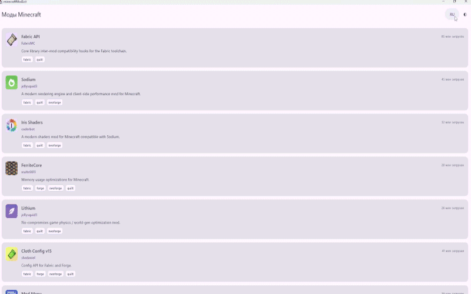
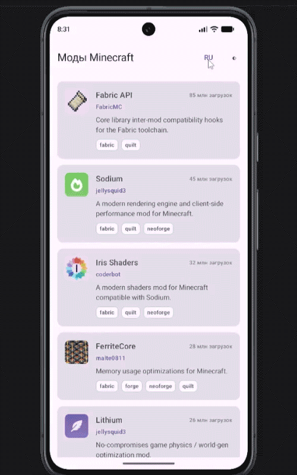

# Minecraft Mod List (CMP)

Кроссплатформенное приложение на **Compose Multiplatform (CMP)** со списком модов для Minecraft, использующее структуру данных API [Modrinth](https://docs.modrinth.com/api/).

---

## Демонстрация работы

| Desktop (JVM) | Android |
| :---: | :---: |
|  |  |

---

## Стек технологий

- **Язык:** Kotlin Multiplatform (2.4.20)
- **UI:** Compose Multiplatform (1.12.1) + Material 3
- **Навигация:** JetBrains `org.jetbrains.androidx.navigation3:navigation3-ui` (Navigation 3)
- **Загрузка изображений:** Coil 3 (`io.coil-kt.coil3:coil-compose`) + OkHttp Network Engine
- **Локализация:** `composeResources` с паритетом ключей (RU / EN)
- **Архитектура:** UDF (Unidirectional Data Flow) / MVI

---

## Реализованный функционал (Веха В1)

- **Типобезопасная навигация (Navigation 3):**
  - Маршруты оформлены как `sealed interface Screen : NavKey` (`Screen.ModList` и `Screen.ModDetail(modId)`).
  - Зеркальные переходы: прямой переход (`slideInHorizontally + fadeIn`) и возврат назад (`popTransitionSpec`).
- **UDF / Состояние:**
  - Экраны принимают стабильное состояние (`ModListState`, `ModDetailState`) и колбэки действий, сохраняя функции `restartable skippable`.
- **Локализация в рантайме:**
  - Поддержка двух локалей (Русский / Английский) в памяти сессии.
  - Паритет ключей проверяется скриптом `tools/check-strings.py`.
- **Динамическая тема:**
  - Переключение светлой и тёмной темы в памяти сессии через тогл `◐` на базе дизайн-токенов `MaterialTheme`.
- **Модели и моки по контракту Modrinth API:**
  - 21 реальный мод с описаниями, категориями, версиями, авторами и иконками.
  - Поддержка цепочек зависимостей модов с возможностью перехода к моду-зависимости.

---

## Запуск проекта

### Desktop
```bash
./gradlew :desktopApp:run
```

### Android
```bash
./gradlew :androidApp:installDebug
```

### Проверка паритета строк
```bash
python tools/check-strings.py
```
